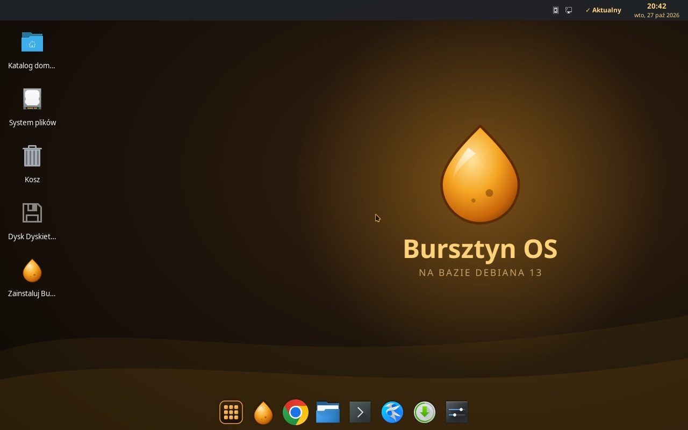
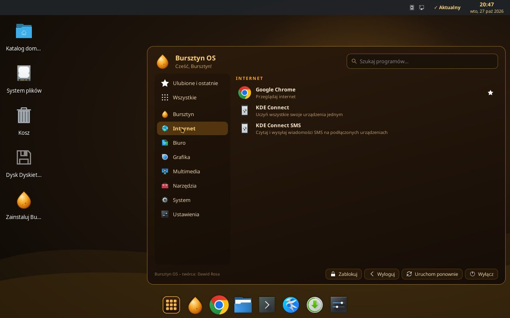
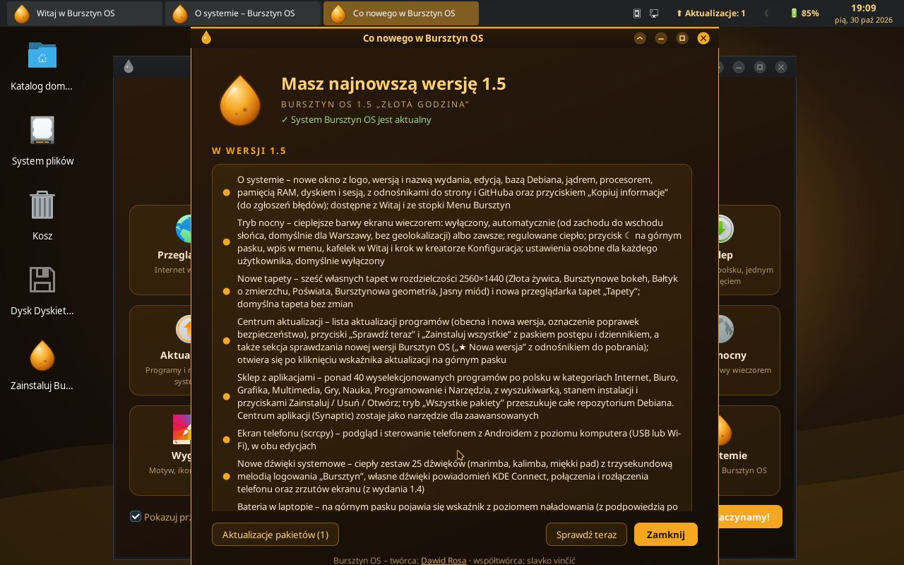
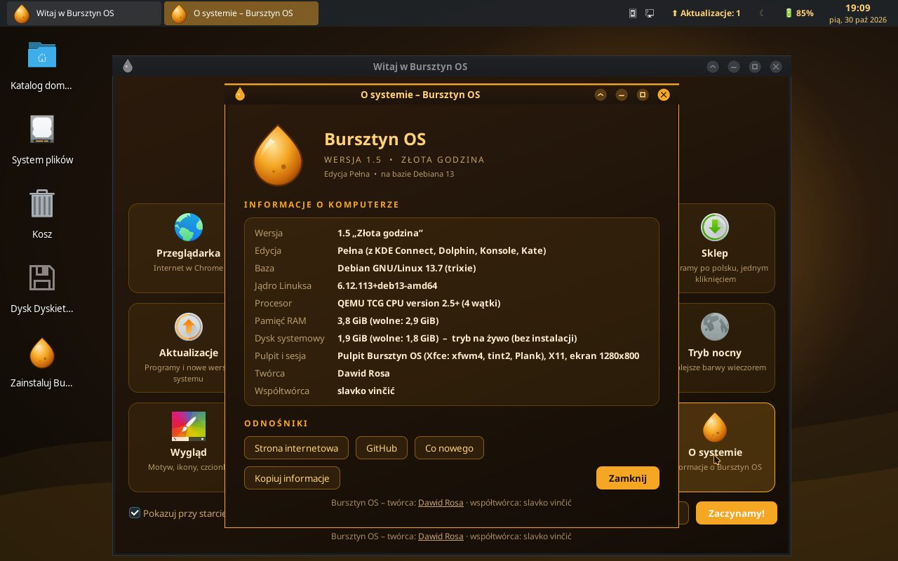
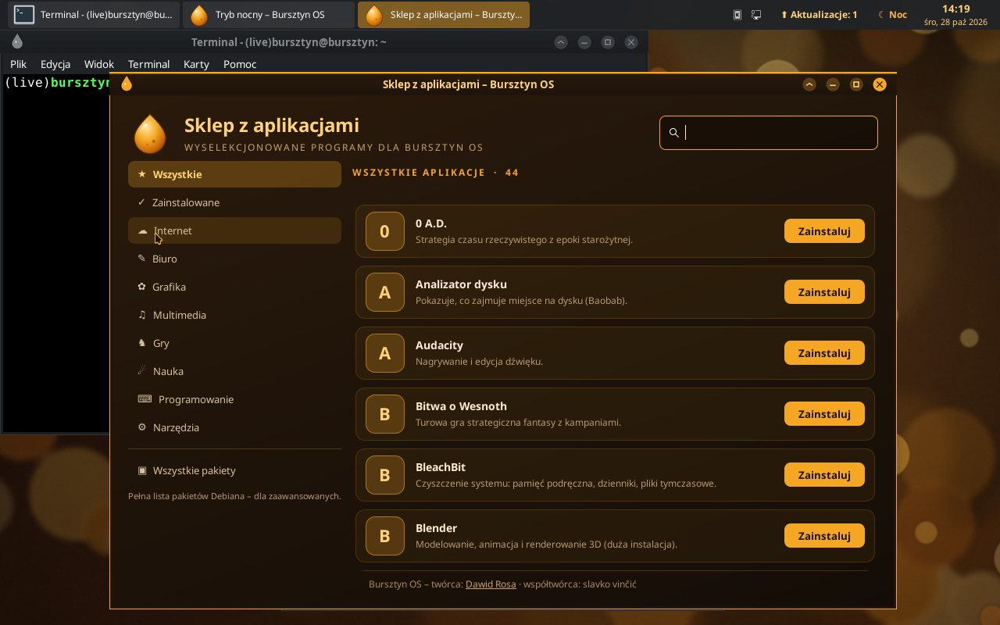
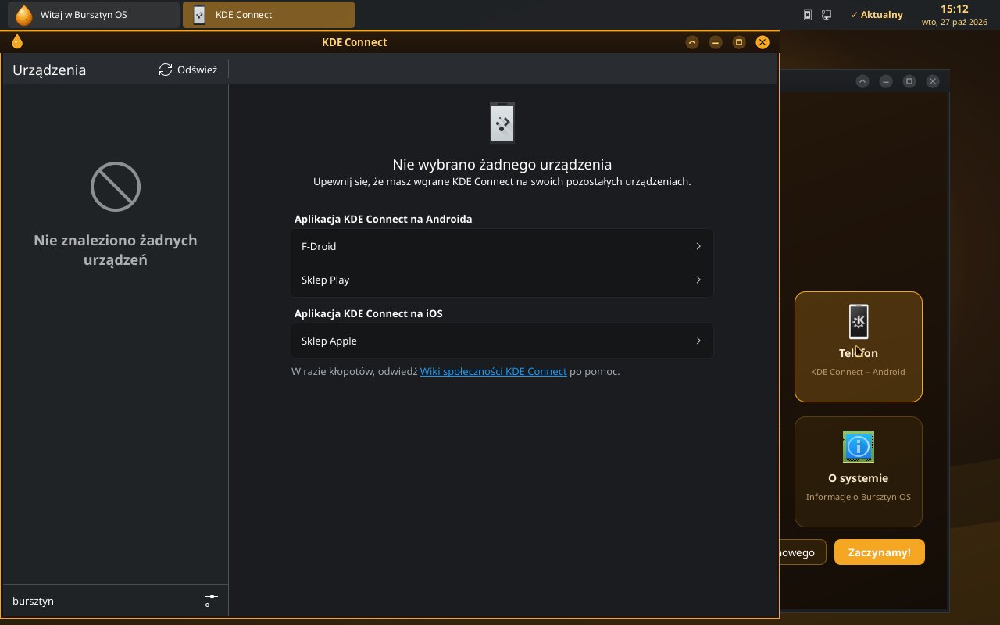
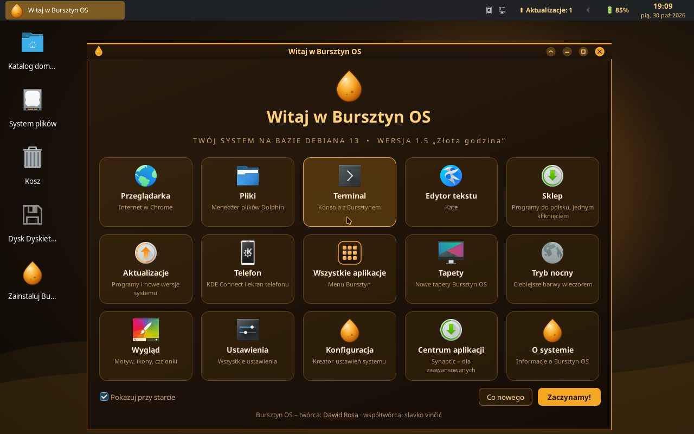

<div align="center">


# Bursztyn OS

**Polski remiks Debiana 13 w ciepłych, bursztynowych kolorach – po polsku od pierwszego uruchomienia.**


-A81D33)


**Najnowsze wydanie: 1.5 „Złota godzina” – 6.11.2026**

[🌐 Strona projektu](https://dawidrosa026-lang.github.io/bursztyn-os/) ·
[⤓ Pobierz 1.5](https://github.com/dawidrosa026-lang/bursztyn-os/releases/tag/v1.5) ·
[📰 Aktualności](https://dawidrosa026-lang.github.io/bursztyn-os/aktualnosci.html) ·
[❓ FAQ](https://dawidrosa026-lang.github.io/bursztyn-os/o-projekcie.html)

**Twórca i opiekun projektu: [Dawid Rosa](https://github.com/dawidrosa026-lang)**

<a href="img/zrzuty/pulpit.jpg"></a>

</div>

## Czym jest Bursztyn OS?

Bursztyn OS to **polski remiks Debiana 13 (trixie)**: ten sam stabilny system i te same pakiety, ale z gotowym,
dopracowanym pulpitem w ciepłych, bursztynowych kolorach i polskim interfejsem od pierwszego uruchomienia.
Aktualizacje (w tym poprawki bezpieczeństwa) przychodzą z oficjalnych repozytoriów Debiana.
Obraz ISO można uruchomić na żywo z pendrive’a (BIOS i UEFI) bez instalowania i zainstalować na dysku, gdy system się spodoba.

Dostępne są dwie edycje:

- **Pełna** – pulpit z aplikacjami KDE (Dolphin, Konsole, Kate, Okular, Gwenview, Ark, Spectacle, KCalc) i przeglądarką Google Chrome. Dla większości współczesnych komputerów.
- **Lite** – lżejsza edycja dla słabszych i starszych komputerów: lekkie aplikacje GTK (Thunar, Terminal XFCE, Mousepad, Atril, Ristretto, Xarchiver, Galculator) i Firefox ESR, ten sam bursztynowy wygląd.

## Najważniejsze cechy

- 🎨 **Breeze Dark + bursztyn** – ciemny motyw Breeze, własny bursztynowy motyw okien, kursor, tapety, ciepłe dźwięki systemowe (od 1.4 nowy zestaw 25 dźwięków z melodią logowania) i animowany ekran startowy (Plymouth).
- 🎵 **Piosenka projektu** – „Bursztynowy kod”, ambientowy synthwave Dawida Rosy (stworzona w Suno): [posłuchaj](https://suno.com/s/g9peTz1175w3Qrm3) lub na stronie projektu.
- 🇵🇱 **Po polsku od startu** – polski interfejs, tłumaczenia aplikacji i polski instalator; od 1.4 także menu startowe GRUB i komunikaty sieciowe.
- ▦ **Menu Bursztyn** (od 1.3) – bursztynowy panel z wyszukiwarką działającą od razu (także bez polskich znaków), ulubionymi i ostatnio używanymi programami, polskimi kategoriami i przyciskami Zablokuj / Wyloguj / Uruchom ponownie / Wyłącz.
- ⬓ **Dock (Plank) i górny pasek** – dock na dole ekranu z Menu po lewej stronie; górny pasek z zegarem, datą z kalendarzem, zasobnikiem systemowym i wskaźnikiem aktualizacji.
- ☺ **Ekran powitalny „Witaj”** – skróty do plików, terminala, ustawień, tapet, Centrum aplikacji i (od 1.4) telefonu oraz kreatora Konfiguracja.
- 🧭 **Kreator „Konfiguracja Bursztyn OS”** (od 1.2) – przy pierwszym uruchomieniu pomaga połączyć się z siecią, wybrać wygląd, ustawić aktualizacje i doinstalować popularne programy.
- ↻ **Aktualizacje i „Co nowego”** – codzienne sprawdzanie aktualizacji, Centrum aplikacji z opcją „Zaznacz wszystkie aktualizacje” oraz powiadomienie „★ Nowa wersja” z listą zmian (okno „Co nowego”).

<div align="center">

<a href="img/zrzuty/menu-bursztyn.jpg"></a>
<a href="img/zrzuty/co-nowego.jpg"></a>

</div>

### ✨ Nowość w 1.5 „Złota godzina”

- **Nowy instalator (edycja Pełna)** – krok „Dysk – jak to działa” z prostym opisem po polsku, wybór pamięci wymiany (bez wymiany, mała wymiana, hibernacja albo plik wymiany), ext4 jako domyślny system plików (do wyboru btrfs i xfs), partycja EFI 300 MiB.
- **Dual boot z Windowsem** – opcja „Zainstaluj obok”, a GRUB (z włączonym `os-prober`) sam pokazuje inne zainstalowane systemy. Sprawdzone na **symulowanym dysku z Windowsem** w maszynie wirtualnej (UEFI i BIOS; dane na partycji NTFS nienaruszone). Nie testowano prawdziwego Windowsa, Secure Boot ani BitLockera – przed instalacją obok Windowsa zrób kopię ważnych danych.
- **O systemie** – okno z wersją, edycją, jądrem, procesorem, RAM-em i dyskiem oraz przyciskiem „Kopiuj informacje” (do zgłoszeń błędów); współtwórca wymieniony obok twórcy.
- **Tryb nocny** – cieplejsze barwy ekranu wieczorem (automatycznie, zawsze albo wyłączony), przycisk ☾ na górnym pasku.
- **Nowe tapety** – sześć tapet 2560×1440 i przeglądarka tapet „Tapety”.
- **Centrum aktualizacji** – lista aktualizacji programów, „Sprawdź teraz”, „Zainstaluj wszystkie” i sprawdzanie nowej wersji Bursztyn OS.
- **Sklep z aplikacjami** – ponad 40 wyselekcjonowanych programów po polsku z wyszukiwarką; tryb „Wszystkie pakiety” przeszukuje całe repozytorium Debiana.
- **Ekran telefonu (scrcpy)** – podgląd i sterowanie telefonem z Androidem (USB lub Wi-Fi); scrcpy pochodzi z `trixie-backports` (włączone z niskim priorytetem – nic nie instaluje się stamtąd samo).
- **Bateria w laptopie** – wskaźnik na górnym pasku oraz dźwięki podłączenia/odłączenia ładowarki i ostrzeżenia o niskim poziomie baterii; w Lite dźwięk migawki przy zrzucie ekranu.
- **Powiększanie kursora po potrząśnięciu myszą (obie edycje)** – gdy szybko poruszysz myszą w lewo i w prawo, kursor na ok. 1 s robi się duży (3×), żeby łatwiej go znaleźć. Lekki pomocnik w sesji X11, włączany i wyłączany w oknie „Powiększanie kursora” (Menu → Ustawienia) albo plikiem `~/.config/bursztyn-kursor-off`.
- **Gry** – nowa kategoria „Gry” w Menu Bursztyn, wszystkie po polsku: w edycji Pełnej 14 gier KDE (Pasjans, KMiny, KBloki, KSudoku, Mahjongg, KBreakOut, Kapman, KDiament, KGoldrunner, Bitwa Morska, Bombowiec, Skoczki – szachy, Kolorowe linie, KReversi), w Lite 7 lekkich gier GNOME (Pasjans AisleRiot, Miny, Sudoku, Quadrapassel, Szachy, Madżong, Reversi). Pełna urosła o ok. 37 MB, Lite o ok. 14 MB.
- **Lepsza obsługa prawdziwego sprzętu (obie edycje)** – firmware kart graficznych AMD Radeon, Intel i innych (`firmware-amd-graphics`, `firmware-intel-graphics`, `firmware-misc-nonfree`) oraz dźwięku nowszych laptopów (`firmware-sof-signed`), a także poprawka startu ekranu logowania na laptopach z dwiema kartami graficznymi (LightDM nie czeka na „graficzną” sesję logind) – problem wykryty na Sony VAIO. W Lite dodano też `xinit`. Obrazy urosły o ok. 90 MB (Pełna) i ok. 61 MB (Lite).
- **Regulacja głośności (obie edycje)** – ikona głośnika w górnym pasku z suwakiem i wyciszeniem (po polsku; kółko myszy zmienia głośność, środkowy przycisk wycisza) oraz działające klawisze głośności i wyciszenia w laptopach.
- **Nowa ikona instalatora (obie edycje)** – bursztynowy pendrive ze strzałką instalacji zamiast ikony płyty/logo, na pulpicie sesji na żywo („Zainstaluj Bursztyn OS”) i w Menu.

<p align="center">
<a href="img/zrzuty/o-systemie.jpg"></a>
<a href="img/zrzuty/sklep.jpg"></a>
</p>

### 📱 KDE Connect (od 1.4) – telefon z Androidem połączony z komputerem

**KDE Connect** łączy telefon z Androidem z komputerem przez tę samą sieć Wi-Fi – bez kabla i bez zakładania konta.
Na telefonie wystarczy darmowa aplikacja KDE Connect (Google Play lub F-Droid); po stronie komputera nic nie instalujesz.

- przesyłanie plików i linków w obie strony,
- powiadomienia z telefonu na pulpicie i odpowiadanie na SMS-y z klawiatury komputera,
- wspólny schowek,
- telefon jako pilot do muzyki, filmów i prezentacji,
- „Znajdź telefon” (dzwonek nawet przy wyciszeniu) i poziom baterii telefonu.

KDE Connect jest w **obu edycjach, także w Lite**: ikona w zasobniku na górnym pasku, kafelek „Telefon” na ekranie
powitalnym i wpis w Menu → Internet.

<p align="center">
<a href="img/zrzuty/kde-connect.jpg"></a>
<a href="img/zrzuty/ekran-powitalny.jpg"></a>
</p>

## Pobieranie – wersja 1.5 „Złota godzina”

| Edycja | Plik | Rozmiar | SHA-256 |
|---|---|---|---|
| **Pełna** (KDE, Google Chrome) | [`bursztyn-os-1.5-amd64.iso`](https://github.com/dawidrosa026-lang/bursztyn-os/releases/download/v1.5/bursztyn-os-1.5-amd64.iso) ([.sha256](https://github.com/dawidrosa026-lang/bursztyn-os/releases/download/v1.5/bursztyn-os-1.5-amd64.iso.sha256)) | ok. 1,85 GB (1 851 359 232 B) | `851db1f4800924f9ccf9cb0e1f6afc636efa28cfd2362c677e4eea7f914dd092` |
| **Lite** (lekkie aplikacje, Firefox ESR) | [`bursztyn-os-lite-1.5-amd64.iso`](https://github.com/dawidrosa026-lang/bursztyn-os/releases/download/v1.5/bursztyn-os-lite-1.5-amd64.iso) ([.sha256](https://github.com/dawidrosa026-lang/bursztyn-os/releases/download/v1.5/bursztyn-os-lite-1.5-amd64.iso.sha256)) | ok. 1,11 GB (1 114 193 920 B) | `d37047d6c2b9b0663fc22e3dc07f2fee1270c58ab2923ebd81f245f242a7486b` |

Strona wydania: <https://github.com/dawidrosa026-lang/bursztyn-os/releases/tag/v1.5>

**Wymagania**

| | Pełna | Lite |
|---|---|---|
| Procesor | 64-bitowy (amd64) | 64-bitowy (amd64) |
| Pamięć RAM | 4 GB (zalecane) | 1,5 GB (min. 1 GB) |
| Miejsce na dysku | 20 GB | 10 GB |

Do nagrania obrazu potrzebny jest pendrive o pojemności co najmniej 4 GB. Obrazy uruchamiają się w trybie BIOS i UEFI.

## Instalacja w skrócie

1. **Sprawdź sumę SHA-256** pobranego pliku (musi być taka jak w tabeli powyżej):
    - Linux: `sha256sum -c bursztyn-os-1.5-amd64.iso.sha256` (wynik „OK”) albo `sha256sum bursztyn-os-1.5-amd64.iso`,
    - Windows: `Get-FileHash .\bursztyn-os-1.5-amd64.iso -Algorithm SHA256` (PowerShell),
    - macOS: `shasum -a 256 bursztyn-os-1.5-amd64.iso`.
2. **Nagraj obraz na pendrive** (dane na pendrivie zostaną usunięte): [balenaEtcher](https://etcher.balena.io/) (Windows, macOS, Linux),
   Rufus (Windows, w trybie obrazu DD) albo `dd` w Linuksie. Szczegółowe kroki: [strona Pobierz](https://dawidrosa026-lang.github.io/bursztyn-os/pobierz.html).
3. **Uruchom komputer z pendrive’a** (w razie potrzeby wybierz urządzenie startowe w menu BIOS/UEFI) i wybierz „Uruchom Bursztyn OS (na żywo)”,
   aby wypróbować system bez instalowania, albo od razu „Zainstaluj Bursztyn OS” (w Lite: „Zainstaluj Bursztyn OS Lite”).
4. **Zainstaluj** – w edycji pełnej instalator **Calamares** (ikona „Zainstaluj Bursztyn OS” na pulpicie), w Lite instalator Debiana uruchamiany z menu startowego (po ponownym uruchomieniu z nośnika); przed instalacją zrób kopię ważnych danych.
   Po pierwszym uruchomieniu zainstalowanego systemu pojawi się kreator „Konfiguracja Bursztyn OS”.

> **Aktualizacja z 1.4:** wersji 1.5 nie da się zainstalować przez Centrum aplikacji ani `apt` – zainstaluj 1.5 z obrazu ISO.
> Na komputerach z 1.4 pojawi się „★ Nowa wersja” z listą zmian.

## Historia wersji

| Wersja | Data | Co nowego |
|---|---|---|
| **1.5 „Złota godzina”** | 6.11.2026 | Nowy instalator (wybór pamięci wymiany, ext4, dual boot „Zainstaluj obok” z os-prober), okno „O systemie”, tryb nocny, nowe tapety, Centrum aktualizacji, Sklep z aplikacjami, ekran telefonu (scrcpy), wskaźnik baterii z dźwiękami ładowarki, dźwięk zrzutu w Lite |
| **1.4 „Bursztynowy most”** | 29.10.2026 | KDE Connect w obu edycjach, nowy zestaw 25 dźwięków systemowych (z nową melodią logowania, dźwiękami telefonu i zrzutów ekranu), menu startowe GRUB i nazwy połączeń sieciowych po polsku, brak wygaszania ekranu w trybie na żywo, ustawienia zasilania ekranu po instalacji, poprawiony baner instalatora Lite |
| **1.3 „Miodowy blask”** | 25.10.2026 | Nowe Menu Bursztyn: wyszukiwarka, ulubione i ostatnio używane programy, polskie kategorie, przyciski zasilania, własna ikona w docku; poprawki bezpieczeństwa Debiana 13 |
| **1.2 „Bursztynowy świt”** | 21.10.2026 | Kreator „Konfiguracja Bursztyn OS”, działające od razu aktualizacje po instalacji, polskie foldery i menu, poprawki instalatora |
| **1.1 „Złota iskra”** | 19.10.2026 | Powiadomienia o nowych wersjach od razu po instalacji, poprawki bezpieczeństwa, polskie litery w menu startowym, mniejsze obrazy ISO |
| **1.0 „Pierwsza kropla”** | 16.10.2026 | Pierwsze wydanie: pulpit na bazie Debiana 13 z aplikacjami KDE, dock z Menu, górny pasek, ekran powitalny, Centrum aplikacji, bursztynowy motyw |

Pełne listy zmian: [Aktualności](https://dawidrosa026-lang.github.io/bursztyn-os/aktualnosci.html) i [`manifest.json`](manifest.json).

## Twórca

**Bursztyn OS stworzył i rozwija [Dawid Rosa](https://github.com/dawidrosa026-lang)** ([@dawidrosa026-lang](https://github.com/dawidrosa026-lang)) – twórca i opiekun projektu.

**Współtwórca: slavko vinčić** – asystent AI, który pomaga Dawidowi budować system: przygotowuje wydania, obrazy ISO i stronę.

Bursztyn OS jest niezależnym projektem opartym na Debianie i **nie jest oficjalnym projektem Debiana**. Debian jest znakiem towarowym Software in the Public Interest, Inc.
Edycja pełna zawiera przeglądarkę Google Chrome, która ma własną licencję Google.

---

## Dla twórców strony

To repozytorium zawiera też **statyczną stronę projektu** (HTML + CSS + trochę JavaScriptu) publikowaną przez GitHub Pages:
<https://dawidrosa026-lang.github.io/bursztyn-os/>. Nie wymaga budowania – wystarczy zawartość tego folderu na hostingu plików statycznych.
Dane twórcy są w `data/strona.json` (pole `tworca`); `generuj.py` wstawia je do stopki, `<meta name="author">`, sekcji „Twórca” i `feed.xml`.

### Struktura

```
├── index.html          Strona główna: hero, funkcje, zrzuty ekranu, tapety, najnowsze ogłoszenia
├── pobierz.html        Pobieranie: karty wydań, weryfikacja SHA-256, nagrywanie pendrive'a
├── aktualnosci.html    Ogłoszenia i wydania (z manifest.json + data/ogloszenia.json)
├── o-projekcie.html    O projekcie i FAQ
├── 404.html            Strona „nie znaleziono”
├── manifest.json       Manifest wersji – ten sam format, który czyta system (nowa-wersja.sh / co-nowego.py)
├── feed.xml            Kanał RSS (generowany przez generuj.py)
├── generuj.py          Generator: RSS + statyczne fragmenty HTML (dla użytkowników bez JS)
├── data/               wydania.json (rozmiar, sha256, linki), ogloszenia.json, strona.json
├── css/style.css       Wygląd (ciemny bursztyn, responsywny)
├── js/main.js          Menu mobilne, podgląd zrzutów, kopiowanie sum, odświeżanie danych z JSON
└── img/                Logo, favicony, zrzuty ekranu i tapety (JPG + WebP)
```

### Jak działają dane

- Treść wydań i ogłoszeń jest wpisana na stałe w HTML przez `generuj.py` (między znacznikami `<!-- GEN:… -->` i `<!-- /GEN:… -->`), więc strona działa bez JavaScriptu. Nie edytuj ręcznie treści między znacznikami `GEN` – generator ją nadpisze.
- `js/main.js` dodatkowo czyta `data/wydania.json`, `manifest.json` i `data/ogloszenia.json` i odświeża te same sekcje (RSS i wersja bez JS wymagają generatora).
- Ogłoszenia = wpisy z `data/ogloszenia.json` + po jednym wpisie „Wydanie: …” dla każdej pozycji `historia` w `manifest.json`.

### Wydanie nowej wersji (np. 1.6)

1. Opublikuj pliki ISO i `.sha256` w GitHub Releases (tag `vX.Y`; limit 2 GiB na plik, ISO nie trafiają do repozytorium – limit 100 MB).
2. W `data/wydania.json` zaktualizuj karty wydań: `nazwa`, `wersja`, `data`, `plik`, `rozmiar`, `sha256`, `url`, `url_sha256`, `status: "gotowe"`.
3. W `manifest.json` ustaw `wersja`, `data`, `nazwa`, `zmiany`, `pobierz` i dopisz wpis **na górze** listy `historia`.
4. Opcjonalnie dodaj ogłoszenie w `data/ogloszenia.json`.
5. Uruchom generator i sprawdź poprawność:
   ```bash
   python3 -m json.tool manifest.json > /dev/null && python3 -m json.tool data/wydania.json > /dev/null
   python3 generuj.py
   python3 -m http.server 8088      # podgląd: http://localhost:8088
   ```
6. Wyślij zmiany do repozytorium (GitHub Pages: gałąź `main`, folder `/`; plik `.nojekyll` jest dodany) i uaktualnij tabelę pobierania oraz historię w tym README.

### Powiadomienia o nowej wersji w systemie

System czyta manifest z adresu `MANIFEST_URL` (w zainstalowanym systemie: `/etc/bursztyn/wersje.conf`).
Wydanie nowej wersji = podmiana `manifest.json` na stronie: komputery z Bursztyn OS pokażą „★ Nowa wersja” i okno „Co nowego”.
Pole `pobierz` w manifeście wskazuje na `pobierz.html`.

---
Bursztyn OS – twórca: [Dawid Rosa](https://github.com/dawidrosa026-lang) · współtwórca: slavko vinčić
